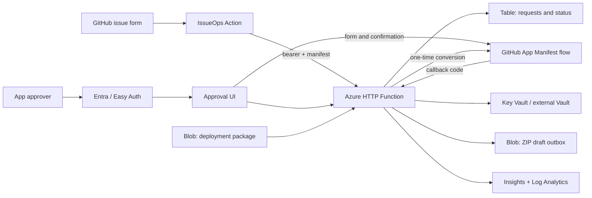
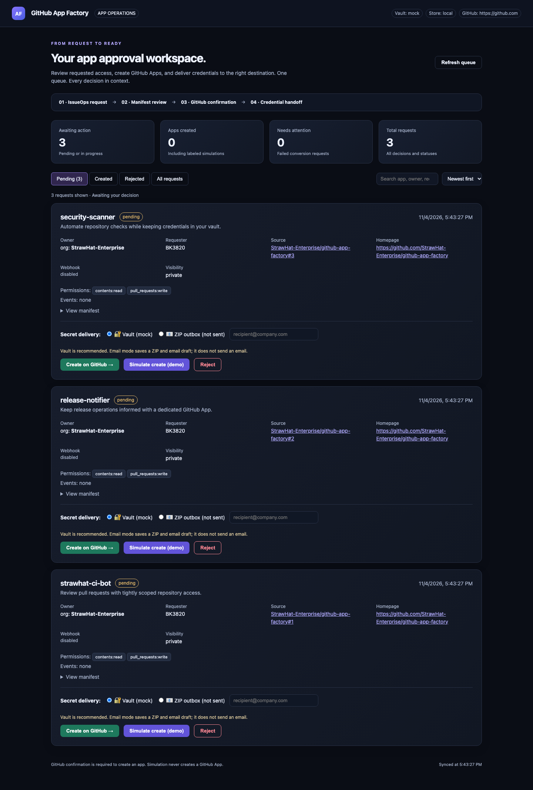
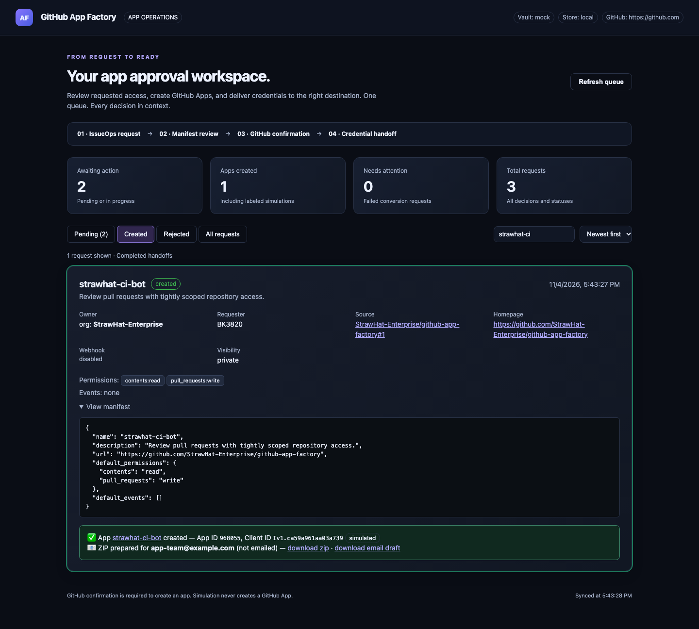
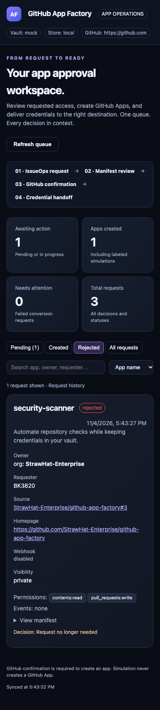

# GitHub App Factory

**IssueOps request → reviewed manifest → GitHub App → secure credential handoff.**

An approval workspace for creating GitHub Apps. GitHub issues are the ServiceNow stand-in for this POC. A workflow queues a manifest, a person confirms creation on GitHub, and the server stores the resulting credentials in Vault or prepares a ZIP outbox.

> **Deployment state:** Azure remains deleted. `APP_FACTORY_ENABLED=false`. The Terraform conversion has been formatted and validated, but **not applied to Azure**. GitHub currently refuses private-repository required reviewers and rulesets on the organization’s plan. An Enterprise-capable plan is needed for native private-repo deployment review. No billing or repository visibility change has been made.

The `production` environment now exists, allows only `main`, and has admin bypass disabled. **Required reviewer enforcement is not installed yet** because GitHub rejected it. The workflow fails closed without that reviewer policy. Squash-only merging and automatic merged-branch deletion are configured.

## End-to-end architecture at a glance



Storage serves runtime coordination, deployment packages, the request table and ZIP outbox. Key Vault holds credentials; Entra authenticates approvers; GitHub’s browser confirmation creates the actual app. [Architecture details](docs/architecture.md) trace every API call and trust boundary. [Cost details](docs/costs.md) show the billing meters and a roughly **$2.85/month** illustrative low-volume Azure subtotal, excluding GitHub plan seats/network/add-ons; this is not a spending cap.

## UI preview

Screenshots below are generated from the actual local app with synthetic requests. They are not evidence of a live Azure deployment or of real GitHub Apps.

### Approval queue



### Completed credential handoff



### Mobile layout



Refresh screenshots after UI changes with `npm run screenshots`. Email mode **does not send email**; it creates a ZIP and `.eml` draft. Vault is recommended.

## Documentation map

| Guide | Contents |
|---|---|
| [Architecture](docs/architecture.md) | System diagram, request sequence, each component, identities, data, endpoints, state transitions, failure boundaries |
| [Cost model](docs/costs.md) | East US 2 USD retail rates, free grants, example calculations, billing meters, cost controls and exclusions |
| [Operations](docs/operations.md) | Terraform lifecycle, state protection, deployment approvals, troubleshooting, rollback, teardown and production gaps |
| [Contributing](CONTRIBUTING.md) | Branch strategy, commits, reviews, test checks, release policy, ownership and ruleset enforcement |
| [Terraform](infra/main.tf) | Runtime infrastructure; replaces the former Bicep template |
| [Main ruleset](.github/rulesets/main.json) | Version-controlled protection policy, applied through GitHub API after the plan upgrade |

## Run locally

Prerequisites: Node.js 22+, npm, Git. Terraform 1.10+ and Azure CLI are needed only for infrastructure.

```bash
git clone https://github.com/StrawHat-Enterprise/github-app-factory.git
cd github-app-factory
npm ci
npm start
```

In another terminal:

```bash
npm run seed
```

Open http://localhost:3000. Local files under `data/` are ignored by Git. Local mode has **no sign-in protection**; do not expose it publicly.

For tests and screenshots:

```bash
npm test
npx playwright install chromium
npm run test:ui
npm run screenshots
terraform -chdir=infra init -backend=false
terraform -chdir=infra fmt -check
terraform -chdir=infra validate
terraform -chdir=infra test
```

Browser tests start/stop their own server, use temporary data, and do not create GitHub Apps or Azure resources.

## Recreate Azure later: step by step

### 1. Finish the GitHub plan upgrade

Keep this repository private. GitHub Team supports private branch protections, but native required environment reviewers for private repositories require an appropriate **Enterprise** plan. Check the [current GitHub feature matrix](https://docs.github.com/en/actions/how-tos/deploy/configure-and-manage-deployments/manage-environments).

### 2. Sign in and verify accounts

```bash
az login
az account set --subscription "Azure subscription 1"
az account show --query '{subscription:name,tenant:tenantId,user:user.name}'
gh auth status
```

The provisioning operator needs Azure resource and role-assignment permissions (Owner or equivalent), permission to manage Entra app registrations, and GitHub repository administration rights.

### 3. Configure repository protection

```bash
node scripts/configure-github.js
```

This configures `production` with **BK3820 as required reviewer**, no admin bypass, deployment from `main` only, and PR/ruleset policy. It fails explicitly if GitHub refuses any required protection. `APP_FACTORY_ENABLED` stays false.

Self-review for **deployment** is intentionally allowed so BK3820 can approve a run they initiated. PR self-approval is different: a second qualified maintainer is required when BK3820 authors a PR. See [Contributing](CONTRIBUTING.md).

### 4. Choose a Terraform backend

Local state is the POC default. It contains the ingestion token and potentially provider-returned sensitive values. Never commit it.

For team use, create a separate private state account and adapt [backend.tf.example](infra/backend.tf.example). Keep backend resources outside the app resource group. Back up state before destroying anything. This extra storage is not created by the application template.

### 5. Provision infrastructure with explicit confirmation

```bash
./scripts/provision.sh
```

The script:

1. Pauses remote jobs and verifies repository approval policy before touching Azure.
2. Reuses or creates UI and OIDC Entra registrations.
3. Configures the deployer OIDC subject for **environment:production**, replacing branch-only credentials.
4. Runs Terraform init, formatting check, validation, and interactive apply.
5. Creates the runtime, storage, secrets, authentication and RBAC.
6. Updates GitHub variables, ingestion-token secret and IssueOps labels.
7. Leaves remote jobs disabled until you explicitly enable them.

Terraform generates new storage/vault names for this deployment. There is no remaining Bicep-managed runtime to import. Retained Entra registrations are managed by the script, not Terraform.

### 6. Enable and request a deployment

```bash
gh variable set APP_FACTORY_ENABLED -R StrawHat-Enterprise/github-app-factory -b true
gh workflow run deploy.yml -R StrawHat-Enterprise/github-app-factory --ref main
```

Only do this once the app resources exist. CI builds/tests first. The `approval` job then opens an issue titled **Deploy &lt;sha&gt; to production** and the run **waits** (up to 6 hours). Nothing touches Azure until BK3820 approves.

Approval works in two layers:

| Layer | Works on current Free plan? | How BK3820 approves |
|---|---|---|
| `approval` job ([trstringer/manual-approval](https://github.com/trstringer/manual-approval), pinned by SHA) | **Yes** | Comment `approve` on the deployment issue (`deny`, or closing the issue, cancels) |
| `production` environment required reviewer | Only after a plan upgrade (API returns 422 today) | Actions run → **Review deployments** → **Approve and deploy** |

Once `configure-github.js` succeeds after the upgrade, both layers apply.

### 7. Approve and verify

Comment `approve` on the deployment issue the run opened. If the environment reviewer is also active (after the upgrade), open the run → **Review deployments** → `production` → **Approve and deploy**. Do not approve failed tests, unexplained permission changes, or the wrong commit.

```bash
curl --fail https://strawhat-ghapp-factory.azurewebsites.net/api/health
```

Expected response: `{"ok":true,"store":"azure-table"}`. This checks handler availability, not storage/Key Vault readiness. Sign in through a browser and test an IssueOps request as well.

### 8. Queue a GitHub App request

Issues → New issue → **GitHub App request**. Fill the form and submit. The workflow posts the manifest, comments the review link and applies `awaiting-approval`.

Open the web app, inspect permissions, choose a delivery destination, then select **Create on GitHub**. GitHub requires browser confirmation and appropriate organization rights. Merely submitting the issue never creates a GitHub App.

## Pause and teardown

```bash
gh variable set APP_FACTORY_ENABLED -R StrawHat-Enterprise/github-app-factory -b false
./scripts/deprovision.sh --confirm
```

Terraform also asks you to confirm destruction. Use the same variables and state/backend as the original apply. Destruction removes only Terraform-managed runtime resources; the provider purges the POC Key Vault on destroy. Storage request history and outbox are deleted. The Entra registrations and GitHub repo survive.

Do not delete the resource group manually after Terraform deployment: that bypasses its state. Read the [teardown and recovery procedure](docs/operations.md) first.

## Configuration

| Setting | Purpose |
|---|---|
| `APP_FACTORY_ENABLED` (GitHub variable) | Gates remote deployment/IssueOps jobs; false while Azure is removed |
| `APP_FACTORY_INGEST_TOKEN` (GitHub secret) | IssueOps bearer credential; copied from sensitive Terraform output to GitHub without logging |
| `AZURE_CLIENT_ID`, `AZURE_TENANT_ID`, `AZURE_SUBSCRIPTION_ID` | OIDC deployment identity configuration, not passwords |
| `AZURE_FUNCTIONAPP_NAME`, `APP_FACTORY_URL` | Deployment and ingestion destinations |
| `INGEST_TOKEN` (app setting) | Key Vault reference in Azure; dev token locally |
| `STORAGE_ACCOUNT_NAME`, `REQUESTS_TABLE`, `OUTBOX_CONTAINER` | Table/Blob backends via managed identity |
| `KEY_VAULT_URL` | GitHub credential storage in Azure Key Vault |
| `VAULT_ADDR`, `VAULT_TOKEN`, `VAULT_KV_MOUNT`, `VAULT_PATH_PREFIX` | Optional external HashiCorp Vault; takes precedence over Key Vault |
| `GITHUB_TOKEN` | Optional result comment; not configured automatically |
| `BASE_URL`, `GITHUB_WEB_URL`, `GITHUB_API_URL` | Callback origin and GitHub/GHES destinations |
| `ALLOW_SIMULATE` | True locally; Terraform defaults false for Azure |

## POC boundaries

Email is not sent or encrypted. Browser-created app credentials cannot currently be recovered automatically if the one-time conversion succeeds but delivery fails. Request updates are not transactional or concurrency-safe. The tenant-wide UI login policy is not an approver allowlist. These and other production gaps are explicitly listed in [Operations](docs/operations.md); this is a working POC, not a fully hardened provisioning service.
