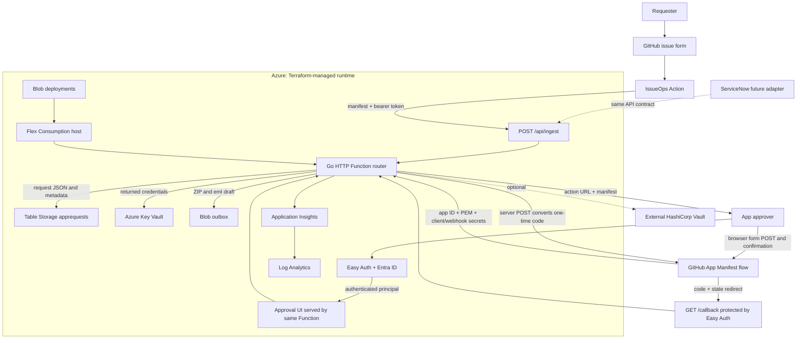
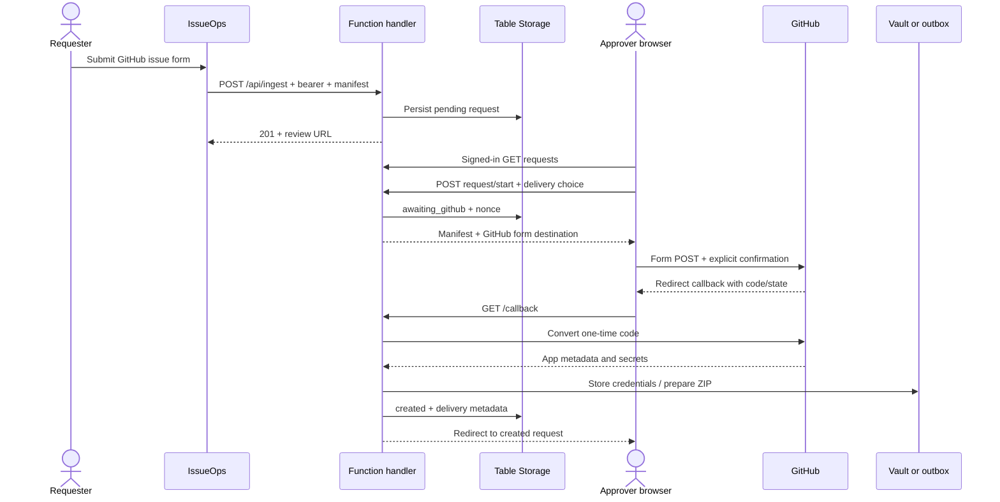

# Architecture and request lifecycle

## End-to-end system

Solid arrows are implemented. ServiceNow adapter and automatic SMTP/ACS delivery are not implemented. A webhook URL in a manifest belongs to the created app’s consuming service; this portal is **not** automatically the webhook receiver.

The Azure deployment is a native Go Functions worker on Linux Flex Consumption. A separate standalone `net/http` entry point uses the same handler for local use and the Docker image. The Docker image is not the package deployed by the current Azure workflow.

## Components and why each exists

| Component | Purpose | Implementation / data |
|---|---|---|
| GitHub issue form | Structured request intake with owner, URLs, permissions and delivery choice | `.github/ISSUE_TEMPLATE/github-app-request.yml`; requester identity from issue event |
| IssueOps workflow | Parse request, create manifest, call ingest, leave review link and label | `.github/workflows/issueops-github-app.yml`; `issues:write`, `contents:read`; only `opened`/matching `labeled` |
| Parser | Converts Markdown sections to GitHub manifest JSON | `scripts/issue-to-request.js`; no-response fields stripped, selected events used only with webhook URL |
| UI | Human access review, queue statistics, search/sort/status filters, delivery choice, GitHub confirmation | `public/index.html`; no raw credential values shown |
| Local server | Development-only `net/http` adapter around the shared application handler | `cmd/server/main.go`; no cloud authentication or automatic email |
| Function entry point | Registers the catch-all HTTP trigger with the Azure Go worker | `main.go`; dashboard HTML is embedded in the binary for ZIP deployment |
| Shared handler | Validation, duplicate checks, status, callbacks and credential handoff | `internal/factory/app.go`; used locally, in Functions and in the container |
| Flex Consumption host | Runs the native Go worker on Linux, scales to zero without always-ready instances | Go runtime `1.0`, built with Go 1.27; 2 GB instances, max 40; package-backed deployment; cold starts possible |
| Standalone container | Local/alternative container-host entry point using the same API | `Dockerfile` and `compose.yaml`; non-root, read-only root filesystem, persistent `/data` volume |
| Functions package | Build artifact consumed by the Azure deployment action | Core Tools `func pack`; Linux x64 package contains `host.json` and the Go binary with embedded UI |
| Easy Auth / Entra | Browser sign-in, authenticated principal metadata | `auth_settings_v2`; excludes only health and ingestion |
| Managed identity | App authenticates to Azure services without account keys/passwords | System-assigned identity; tied to Function App lifecycle |
| Storage: host | Runtime coordination/checkpoints/locks where required | `AzureWebJobsStorage__accountName` + managed identity |
| Storage: Table | Durable pending manifests and status metadata | `apprequests`, partition `request`, row key UUID, JSON string `data` |
| Storage: deployments | Hosting/deployment package container required by Flex | Private Blob container `deployments` |
| Storage: outbox | Credential ZIPs and email drafts for POC download | Private Blob container `outbox`; downloads go through authenticated Function |
| Azure Key Vault | Stores app secrets; holds ingest bearer credential | Standard vault, RBAC, seven-day soft deletion; POC purge on Terraform destroy |
| External HashiCorp Vault | Optional organization-owned secret destination instead of Azure Key Vault | KV v2, `VAULT_ADDR`/token; not provisioned here |
| Application Insights | Request/exception telemetry from Functions | Workspace-linked, local auth disabled, managed identity publishing |
| Log Analytics | Storage/query/retention for telemetry | Analytics logs, 30 days, daily ingestion cap 0.1 GB |
| Entra UI registration | Identifies this web app for tenant sign-in | Reused by provisioning script |
| Entra deployer registration | OIDC token exchange for GitHub Actions | `environment:production` federation; Website Contributor only on Function App |
| Terraform | Declares runtime resources, relationships, roles and secret generation | AzureRM native Flex + AzAPI management-plane containers/table/secret |
| Terraform state | Remembers resource IDs and generated values across plan/apply/destroy | Local POC default; separate encrypted/locked remote backend recommended |

Azure Functions Go support is restricted to Linux Flex Consumption. Core Tools 4.12 or later is required for Go packaging and currently prints a preview warning. The Function host selects the worker from `functionAppConfig.runtime` (`go`, `1.0`); it must not receive a `FUNCTIONS_WORKER_RUNTIME` application setting on Flex.

## Request trace: issue to credential handoff

1. A requester submits the issue form. GitHub stores the request in the private repository. Do not paste credentials into issue fields.
2. `github-app-request` label and event conditions select the IssueOps job; `APP_FACTORY_ENABLED` must be true.
3. Checkout loads the parser. The issue event supplies author, issue number, repository and source URL.
4. The parser builds `name`, `description`, `url`, `public:false`, `default_permissions`, and optional webhook/events.
5. The job POSTs JSON to `/api/ingest` with the ingestion token from a GitHub secret. Easy Auth excludes this endpoint because it is a machine caller; the application validates the bearer itself.
6. The handler checks required fields, organization login, delivery type/email and duplicate names. It generates a UUID and timestamps.
7. Table Storage stores the manifest/request as `pending`. HTTP 201 returns its ID and review URL. HTTP 409 means an existing request; the workflow avoids another comment.
8. The Action comments the generated manifest and link and adds `awaiting-approval`.
9. The approver signs in through Entra/Easy Auth. The authenticated UI calls `/api/config` and `/api/requests`. The state nonce is omitted from the list API.
10. The UI displays requested permissions, source, owner and delivery choice. Draft choices survive refresh/filtering in the browser session; they are not persistent until an action is submitted.
11. **Create on GitHub** POSTs `/api/requests/:id/start`. The handler persists the final delivery choice and principal, generates a random nonce, and changes status to `awaiting_github`.
12. It returns a GitHub action URL with `<request-id>.<nonce>` state and a manifest whose `redirect_url` is the portal `/callback`.
13. The browser submits the manifest to GitHub. The user must confirm it with suitable organization app-creation rights. A request or Actions deployment approval alone does not create an app.
14. GitHub redirects the browser to `/callback?code=...&state=...`. Easy Auth still protects the callback; the browser sign-in/session must work.
15. The server checks state and POSTs the code to GitHub’s manifest-conversion API. **This is a one-time exchange.**
16. GitHub returns app ID, client ID, client secret, private-key PEM and optional webhook secret.
17. Vault mode writes secrets to Azure Key Vault or external HashiCorp Vault. Outbox mode writes a ZIP containing credentials JSON, PEM and a README, plus an `.eml` draft.
18. Only after delivery succeeds does the handler mark `created`, clear the nonce, and retain app metadata plus delivery location/filenames.
19. Optional result commenting requires `GITHUB_TOKEN`; it is not configured by Terraform. The browser redirects to the Created tab.

## State and persistence boundaries

| Status | Meaning | Available path |
|---|---|---|
| `pending` | Intake complete; app not created | Start, simulate if enabled, reject |
| `awaiting_github` | Browser flow started; user may abandon GitHub screen | Start again/reset/reject; old state replaced by a new start |
| `failed` | GitHub conversion returned a non-success HTTP status | Inspect error, reset/start; invalid code cannot simply be reused |
| `created` | Credential handoff succeeded | View metadata/download outbox; starting again is blocked |
| `rejected` | Operator rejected request; reason recorded | View history; matching name may be requested again |

The implementation permits reset/reject endpoints more broadly than the UI exposes them. There is no database transaction, row-version conditional update, state-expiry timestamp, or distributed lock. Concurrent duplicates/actions are not guaranteed safe.

If conversion succeeds but secret delivery fails, GitHub may have already created the app and consumed the code while Table still says `awaiting_github`. Do not blindly retry creation. Recover from GitHub settings and reconcile manually; durable encrypted recovery is future work.

## API and trust boundaries

| Endpoint | Caller/protection | Purpose |
|---|---|---|
| `GET /` | Easy Auth in Azure; open locally | Dashboard HTML |
| `GET /api/config` | Easy Auth | Backend/provider configuration and principal name |
| `GET /api/requests` | Easy Auth | Full request list without state nonce |
| `POST /api/ingest` | Application bearer token | IssueOps/future ServiceNow intake |
| `POST /api/requests/:id/start` | Easy Auth | Persist choices, start GitHub manifest flow |
| `POST /api/requests/:id/simulate` | Easy Auth + feature flag | Fake credentials, same delivery path; no GitHub app |
| `POST /api/requests/:id/reject` / `reset` | Easy Auth | Operator lifecycle actions |
| `GET /callback` | Easy Auth + random state | GitHub code conversion and handoff |
| `GET /outbox/:filename` | Easy Auth | Server-proxied private credential download |
| `GET /api/health` | Public | Handler availability only; no dependency probes |

RBAC grants Blob Data Owner, Table Data Contributor and Queue Data Contributor on this account to the Function identity, Secrets Officer on its vault, and Metrics Publisher on Insights. Website Contributor on the Function App is granted to the deployer. The application storage account disables shared-key access and public blob access.

The browser never receives a storage SAS/account key or raw vault credentials. ZIP downloads do contain secrets. Request JSON should contain no credential material. Terraform state **does** contain the ingestion token; sensitive output flags redact display, not storage.

## Scaling implications

The current list API scans the full table partition and returns every row. Duplicate checks also scan it. The UI auto-refreshes every ten seconds when the user is idle and no manifest is expanded. This amplifies Function executions and Table transactions even when no new issues arrive. Pagination, indexed idempotency, delta polling/server push, archival, and atomic status transitions are prerequisites for large production volume.
